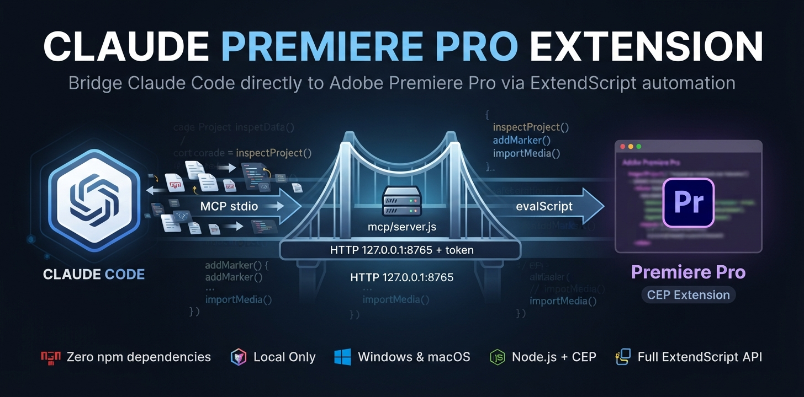

# Claude Premiere Pro Extension



Control **Adobe Premiere Pro** from **Claude Code**. Ask Claude to inspect your project, list sequences and clips, add markers, import media, or run any ExtendScript automation. It all goes through a small, dependency-free bridge that runs only on your own machine.

```
Claude Code ──MCP stdio──▶ mcp/server.js ──HTTP 127.0.0.1:8765 + token──▶ Claude Bridge panel ──evalScript──▶ host.jsx ──▶ Premiere Pro
```

- **Zero npm dependencies.** Plain Node.js and a CEP panel.
- **Local only.** Binds to `127.0.0.1`, needs a per-install bearer token, and rejects browser origins and foreign `Host` headers.
- **Windows and macOS.** Supports Premiere Pro 2020 (14.0) and newer.

## Requirements

| Requirement | Version | Notes |
| --- | --- | --- |
| Adobe Premiere Pro | 2020 (14.0) or newer | Windows or macOS |
| Node.js | 18 or newer | https://nodejs.org (runs the MCP server) |
| Claude Code | latest | CLI (`npm install -g @anthropic-ai/claude-code`) or the desktop app |
| Git | any | to clone the repo |

There are no Python packages and no `npm install` step. See [requirements.txt](requirements.txt).

## Install

### 1. Clone

```bash
git clone https://github.com/MrUzbek00/Claude-Code-Premiere-Pro-Extension.git
```

Keep the folder somewhere permanent. The panel and the MCP server are loaded from it.

### 2. Run the installer

**Windows** (PowerShell, no admin needed):

```bash
powershell -ExecutionPolicy Bypass -File scripts/install.ps1
```

**macOS:**

```bash
bash scripts/install.sh
```

The installer:

1. Links `extension/` into your user CEP extensions folder as `com.claude.premierebridge`. It uses a junction on Windows and a symlink on macOS, so `git pull` updates the panel. Pass `-Copy` / `--copy` to copy the files instead.
2. Turns on `PlayerDebugMode` for CSXS 9–12, which lets Premiere load this unsigned panel.
3. Registers the MCP server with Claude Code: `claude mcp add premiere-bridge --scope user -- node <repo>/mcp/server.js`. Pass `-SkipMcp` / `--skip-mcp` to skip this step.

### 3. Open the panel in Premiere Pro

Restart Premiere Pro, then open **Window → Extensions (Legacy) → Claude Bridge**. On older versions this is **Window → Extensions → Claude Bridge**. The panel shows a green dot and **Bridge running**.

The first time it opens, the panel creates a random token at `~/.premiere-bridge/token`. **The panel must stay open while you use Claude** (you can dock it anywhere).

### 4. Verify

```bash
npm run doctor
```

This checks Node, the panel install, debug mode, the token, the bridge, Premiere's response, and the Claude Code registration. It prints a fix for anything that fails. Then restart Claude Code (or run `/mcp`) and ask:

> Ping Premiere and tell me what project is open.

## Tools Claude gets

| Tool | What it does |
| --- | --- |
| `bridge_ping` | Premiere version, open project, active sequence |
| `bridge_project_info` | Project name, path, sequence count, root item count |
| `bridge_list_sequences` | All sequences with IDs |
| `bridge_list_root_items` | Items in the project's root bin |
| `bridge_active_sequence` | Active sequence: track counts, end, playhead position |
| `bridge_eval` | Runs any ExtendScript in Premiere and returns the last expression's value. **Can modify the project.** |

`bridge_eval` gives Claude the full [Premiere Pro ExtendScript API](https://ppro-scripting.docsforadobe.dev/): timeline edits, markers, imports, bins, exports through Adobe Media Encoder, and more. [CLAUDE.md](CLAUDE.md) gives Claude the conventions it needs (ES3 syntax, time units, return values). Copy it into your own projects, or reference it there, if you use Claude Code outside this folder.

### Example prompts

- "List every clip on my timeline with its start and end time."
- "Add a marker called *Intro end* at the playhead."
- "Import everything in `D:/Footage/Day1` into a bin called *Day 1*."
- "Which sequences in this project are longer than 10 minutes?"

See [examples/](examples/) for ready-made ExtendScript snippets.

## Project layout

```
extension/             CEP panel loaded by Premiere Pro
  CSXS/manifest.xml    extension manifest (Premiere 14.0+, CSXS 11)
  client/              panel UI + localhost HTTP server (Node.js inside CEP)
  host/host.jsx        ExtendScript commands + JSON serializer
mcp/server.js          MCP stdio server for Claude Code (no dependencies)
scripts/               install / uninstall / doctor / package (signed .zxp)
examples/              ExtendScript snippets for bridge_eval
docs/                  architecture and troubleshooting
test/                  node:test suites (no Premiere needed)
CLAUDE.md              guidance Claude Code reads when working in this repo
```

## Configuration

| Variable | Default | Used by |
| --- | --- | --- |
| `PREMIERE_BRIDGE_PORT` | `8765` | panel and MCP server (set the same value for both) |

To set the port for the MCP server, register it with an env var:

```bash
claude mcp add premiere-bridge --scope user -e PREMIERE_BRIDGE_PORT=8770 -- node /path/to/mcp/server.js
```

The panel reads the variable from the environment Premiere was launched with.

## Updating

```bash
git pull
```

With the default linked install, close and reopen the panel (or restart Premiere) to load the new panel code, and restart Claude Code to pick up the new MCP server code. If you installed with `-Copy` / `--copy`, run the installer again.

## Uninstall

```bash
powershell -ExecutionPolicy Bypass -File scripts/uninstall.ps1
```

```bash
bash scripts/uninstall.sh
```

This removes the panel and the MCP registration. The `~/.premiere-bridge` folder and the `PlayerDebugMode` setting stay in place. Delete them by hand if you no longer need them.

## Signed package (optional)

To install without `PlayerDebugMode`, for example on another machine, build a signed `.zxp` on Windows:

1. Download `ZXPSignCmd.exe` from [Adobe CEP-Resources](https://github.com/Adobe-CEP/CEP-Resources/tree/master/ZXPSignCMD) into `tools/`.
2. Run `powershell -ExecutionPolicy Bypass -File scripts/package.ps1 -Password <choose-one>`.
3. Install `dist/ClaudeBridge-<version>.zxp` with a ZXP installer, then register the MCP server (step 3 of the installer above).

The self-signed certificate is created in `build/cert.p12`. `build/`, `dist/` and `tools/` are git-ignored. Never commit the certificate.

## Development

```bash
npm run check   # syntax check
npm test        # MCP server, ExtendScript host and panel HTTP tests (no Premiere needed)
```

CI runs both on Windows, macOS and Linux with Node 20 and 22 ([.github/workflows/ci.yml](.github/workflows/ci.yml)).

## Security

The bridge can run arbitrary ExtendScript in Premiere, so treat `~/.premiere-bridge/token` like a password. See [SECURITY.md](SECURITY.md).

## Troubleshooting

See [docs/TROUBLESHOOTING.md](docs/TROUBLESHOOTING.md), or run `npm run doctor`.

## License

[MIT](LICENSE)
